# Atividade: Primeiro Teste de Software

**Estudantes:** Jhannyfer Sweyvezes Rodrigues Biângulo e Rafael de Souza Teixeira
**Curso e período:** Bacharelado em Sistemas de Informação, 8º período
**Disciplina:** Teste de Software

## Sistema testado
SauceDemo (https://www.saucedemo.com/)

## Classificação do teste realizado
- **Nível – Sistema:** testamos a loja inteira pelo navegador, como um cliente usaria, e não partes isoladas.
- **Objetivo – Funcional:** verificamos se login, carrinho, imagens e checkout fazem o que deveriam, sem medir tempo, carga ou segurança.
- **Visão do código – Caixa-preta:** só vimos as telas e os resultados, sem nenhum acesso ao código-fonte.
- **Execução – Dinâmico:** o sistema estava rodando e foi usado de verdade durante o teste.
- **Modo – Manual:** nós mesmos executamos cada passo e comparamos o resultado com o esperado, sem script.
- **Motivo – Teste novo:** foi a primeira execução desses casos; se forem repetidos após uma mudança na loja, passam a ser teste de regressão.

Em uma frase: teste manual, funcional, dinâmico, de caixa-preta, no nível de sistema.

## Casos de teste
| ID | Título | Tipo | Resultado esperado | Status |
|----|--------|------|--------------------|--------|
| CT-01 | Login com credenciais válidas | Positivo | Usuário vai para a página Products | Passed |
| CT-02 | Login com senha incorreta | Negativo | Continua no login com mensagem de erro | Passed |
| CT-03 | Adicionar produto ao carrinho | Positivo | Botão vira Remove e carrinho mostra 1 | Passed |
| CT-04 | Imagens dos produtos com problem_user | Positivo | Cada produto mostra a sua própria imagem | **Failed** |
| CT-05 | Adicionar todos os produtos ao carrinho com problem_user | Positivo | Os 6 botões viram Remove e o carrinho mostra 6 | **Failed** |
| CT-06 | Remover produto na página Products com problem_user | Positivo | Botão volta para Add to cart e carrinho fica vazio | **Failed** |
| CT-07 | Login com usuário bloqueado | Negativo | Continua no login com aviso de usuário bloqueado | Passed |
| CT-08 | Checkout sem preencher os dados obrigatórios | Negativo | Não avança e avisa que o primeiro nome é obrigatório | Passed |

Os casos CT-01 a CT-04 são os do roteiro da atividade. CT-05 e CT-06 vieram do teste exploratório, em que percebemos que o carrinho não funcionava direito com o problem_user. CT-07 e CT-08 são testes negativos de login bloqueado e do checkout, onde a venda é concluída.

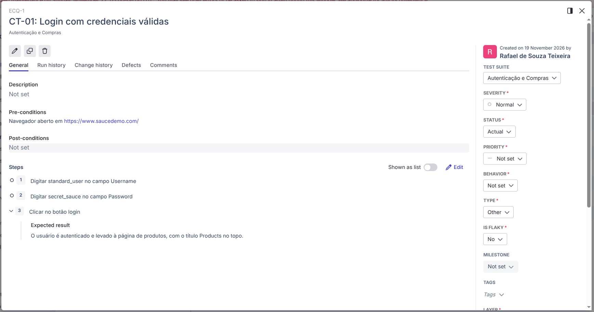

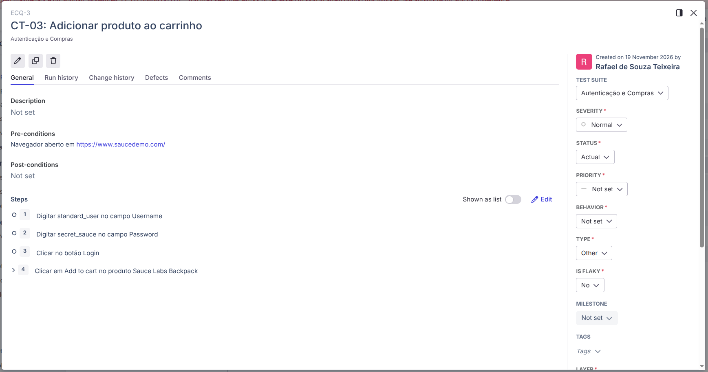
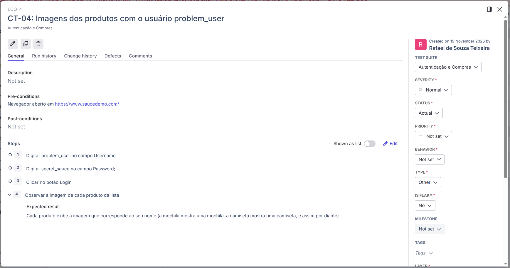
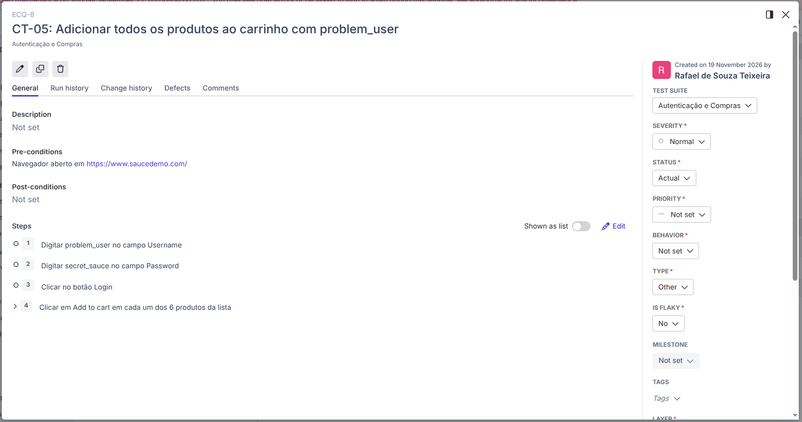
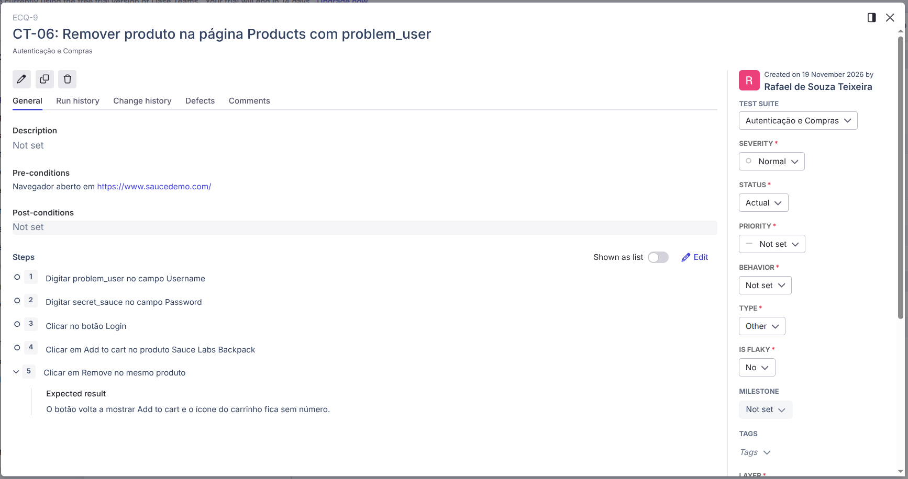
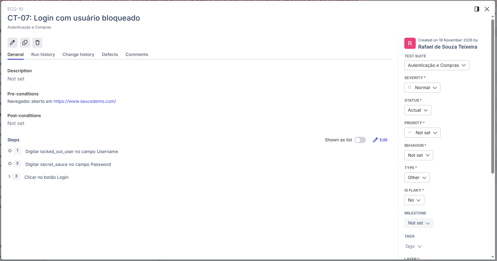
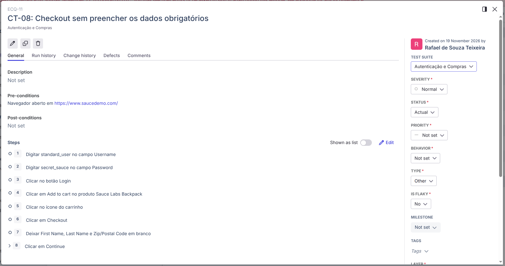

## Execução
Execução de Testes - Ciclo 1: 8 casos, 5 aprovados e 3 reprovados.

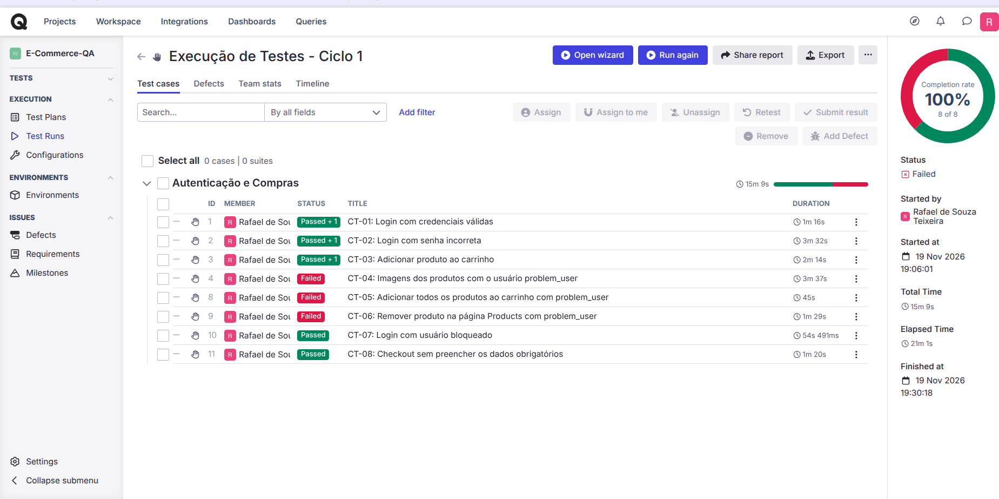

## Evidências da execução (tela do SauceDemo)
| Caso | Status | Evidência |
|------|--------|-----------|
| CT-01 | Passed |  |
| CT-02 | Passed | 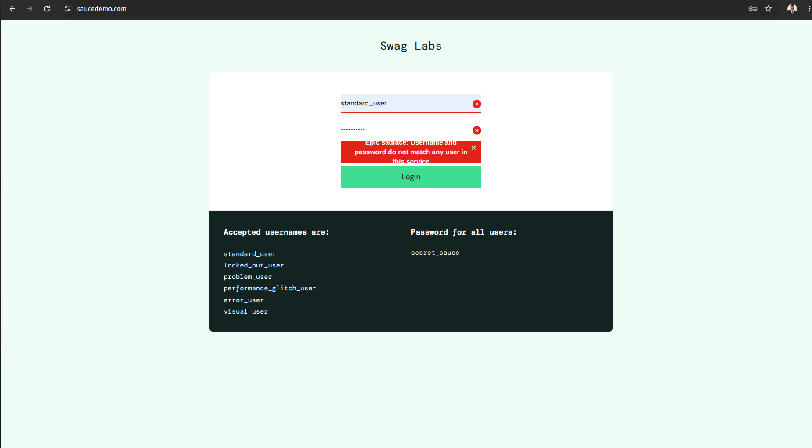 |
| CT-03 | Passed | 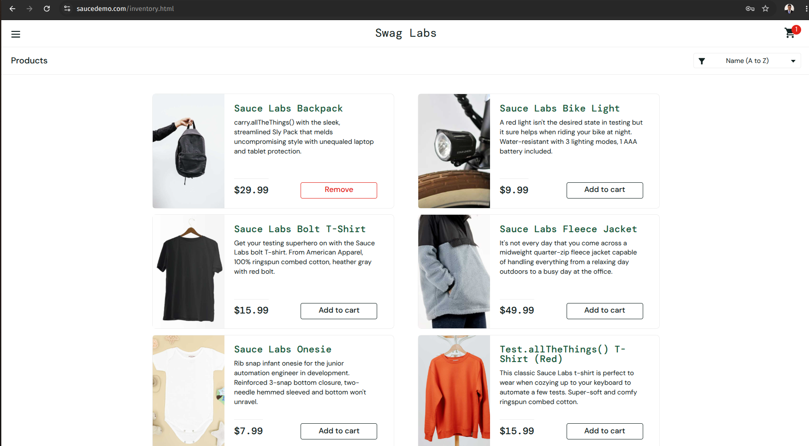 |
| CT-04 | Failed | 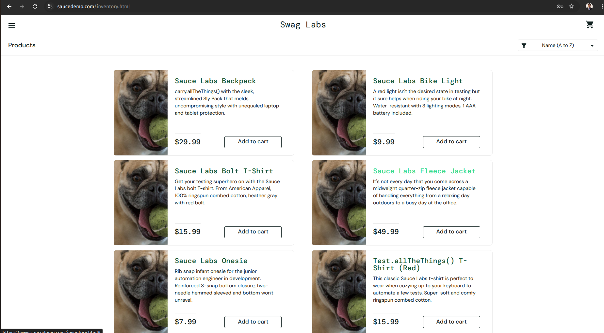 |
| CT-05 | Failed | 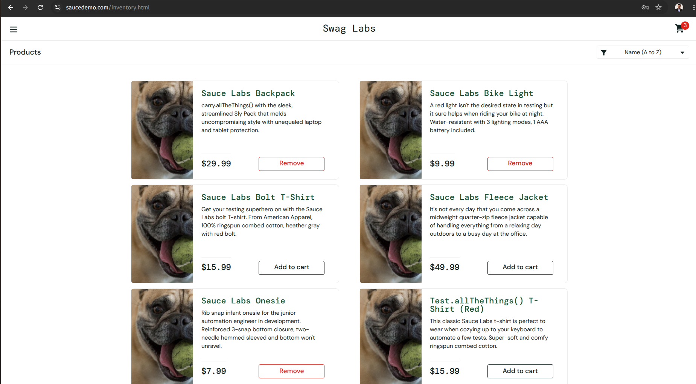 |
| CT-06 | Failed |  |
| CT-07 | Passed | 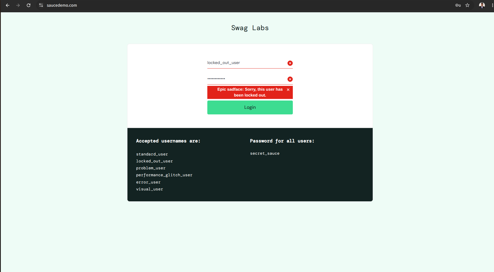 |
| CT-08 | Passed | 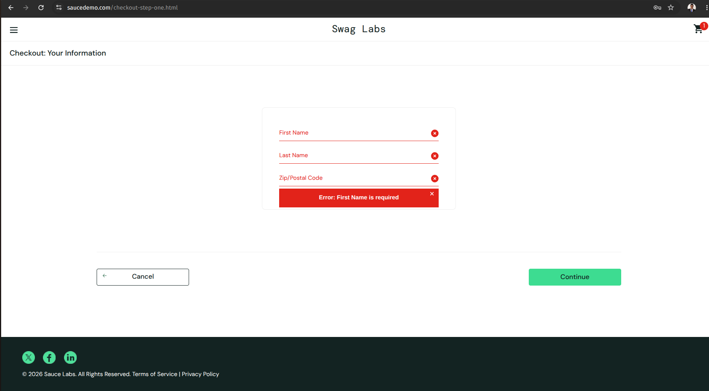 |

## Defeitos encontrados
- Issue #1 – imagens iguais com problem_user (CT-04): https://github.com/RafaelTeixeira1/relatorio-de-bugs-lab/issues/1
- Issue #2 – Add to cart e Remove não funcionam com problem_user (CT-05 e CT-06): https://github.com/RafaelTeixeira1/relatorio-de-bugs-lab/issues/2

## Respostas às perguntas para refletir
1. **Por que o resultado esperado é escrito antes de executar o teste?**
   Porque ele precisa vir da regra do sistema, e não do que aparece na tela. Se olharmos o sistema primeiro, a tendência é aceitar o que vimos como correto. No CT-04, quem já tivesse visto o cachorro em todos os produtos poderia achar que aquilo era normal. Escrever antes é o que permite perceber a diferença.

2. **Qual a diferença entre o caso de teste (CT-04) e o relatório de defeito (a issue)? Por que precisamos dos dois?**
   O caso de teste é o roteiro de verificação: diz o que fazer e o que deveria acontecer, e pode ser executado muitas vezes, passando ou falhando. A issue é o registro de um problema que já aconteceu, com ambiente, resultado obtido, severidade, prioridade e evidência, escrito para quem vai corrigir. Precisamos dos dois porque o caso de teste encontra o defeito e depois confirma a correção, e a issue comunica e acompanha o defeito até ser resolvido. Um mesmo defeito pode ser achado por mais de um caso, como a issue #2, ligada ao CT-05 e ao CT-06. A ligação entre eles é a rastreabilidade.

3. **Podemos afirmar que a loja não tem mais nenhum defeito além do que você encontrou?**
   Não. Testar mostra que defeitos existem, mas não prova que eles não existem. Executamos 8 casos, com poucos dados e um só navegador. Partes como a finalização da compra com dados válidos, o cálculo do total, a ordenação, a página de detalhes do produto e outros navegadores não foram testadas e podem ter defeitos. O próprio teste exploratório achou problemas que não estavam no roteiro inicial.

4. **Se essa loja fosse da sua empresa, o que você testaria a seguir?**
   A compra completa com dados válidos até a tela de confirmação, conferindo subtotal, impostos e total. Depois o checkout com cada campo vazio separadamente, a ordenação por nome e preço, a página de detalhes de cada produto e o logout. Também repetiria os casos com o problem_user nessas telas, em outros navegadores e no celular, e automatizaria os casos que precisam ser repetidos a cada versão (regressão).

5. A resposta da pergunta 5 está na seção "Classificação do teste realizado".

6. **Por que ele não é um teste unitário nem um teste de carga?**
   Não é unitário porque não tivemos acesso ao código nem testamos uma função isolada; testamos a loja inteira pela interface. Não é de carga porque havia um único usuário fazendo o teste, sem simular muitos acessos ao mesmo tempo e sem medir como o sistema se comporta sob volume.
